<div align="center">

# INATrace v2

[Español](README.md) · **English**

**A new web interface for [INATrace](https://github.com/agstack/inatrace-backend), the open-source traceability platform for agricultural supply chains. It is built on the existing backend and leaves it unchanged.**

[](https://github.com/reiterstahl/inatrace-v2/actions/workflows/ci.yml)


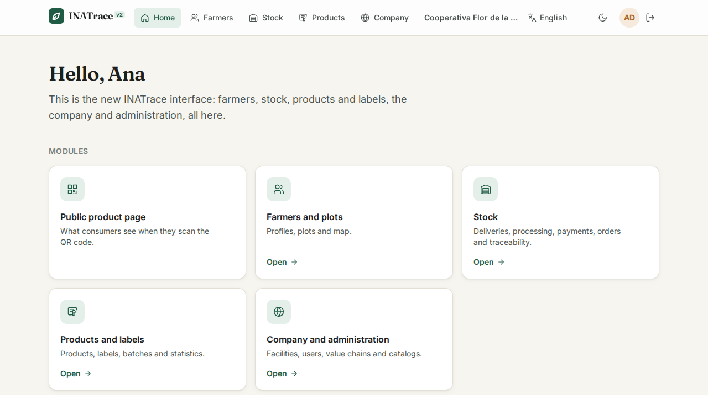

</div>

---

## Contents

- [What it is](#what-it-is)
- [Previews](#previews)
- [What changes from the current interface](#what-changes-from-the-current-interface)
- [Status by module](#status-by-module)
- [Features](#features)
- [Architecture](#architecture)
- [Technology](#technology)
- [Repository layout](#repository-layout)
- [Getting started](#getting-started)
- [Configuration](#configuration)
- [Scripts](#scripts)
- [Tests](#tests)
- [Deployment](#deployment)
- [Security](#security)
- [Contributions to the original project](#contributions-to-the-original-project)
- [Technical decisions](#technical-decisions)
- [Documentation](#documentation)
- [License and credits](#license-and-credits)

---

## What it is

INATrace v2 replaces the INATrace web interface (Angular 10) with a new one in React, one module at a
time. It talks to the **same Java/Spring backend without modifying it** and **runs alongside** the
current interface. A proxy splits the routes on a single domain, so both versions share one session
and users can move between them without signing in again. Anything not yet in v2 opens in the
current version.

It is an independent initiative by Rolando Quirós, separate from the GIZ contracts. The full plan is
in [docs/PLAN.md](docs/PLAN.md) and the detailed status of each phase is in
[docs/AVANCE.md](docs/AVANCE.md) (both in Spanish).

## Previews

> Screenshots of **mock mode** (fictitious data, no backend). Regenerate them with
> `CAPTURAS_IDIOMA=en pnpm capturas`.

<table>
  <tr>
    <td width="50%">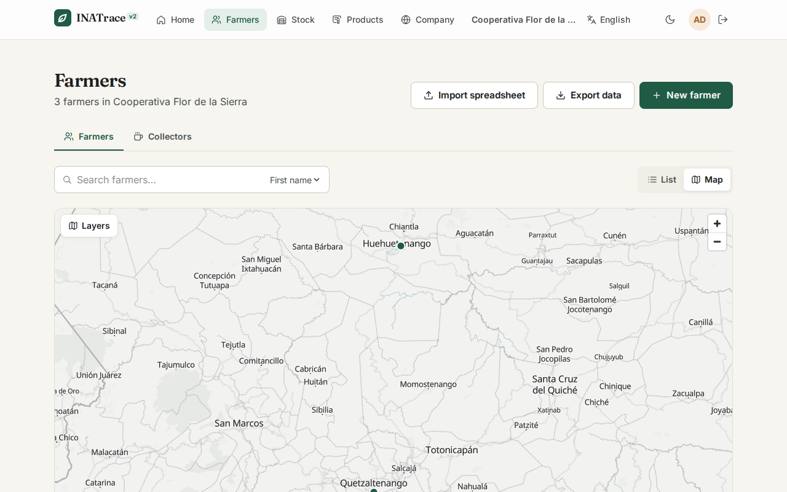<br><sub><b>Farmers on the map</b>: list or map view with catalog layers, no Mapbox token needed.</sub></td>
    <td width="50%">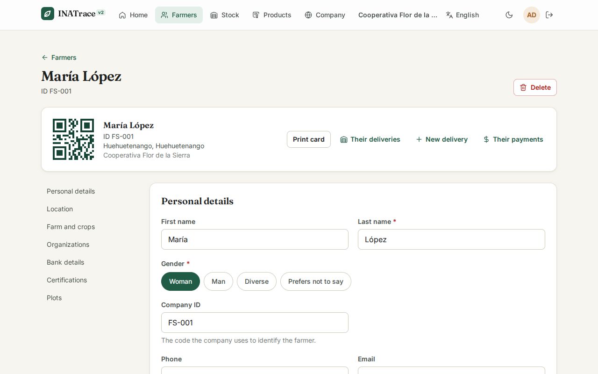<br><sub><b>Farmer profile</b>: personal details, farm, plots, QR card, deliveries and payments.</sub></td>
  </tr>
  <tr>
    <td>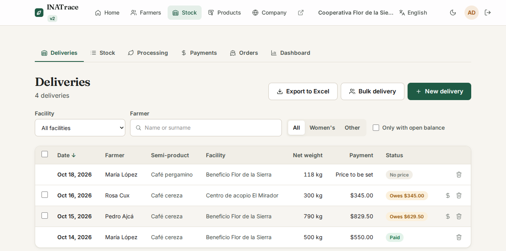<br><sub><b>Deliveries</b>: filters, outstanding balance, bulk delivery and Excel export.</sub></td>
    <td>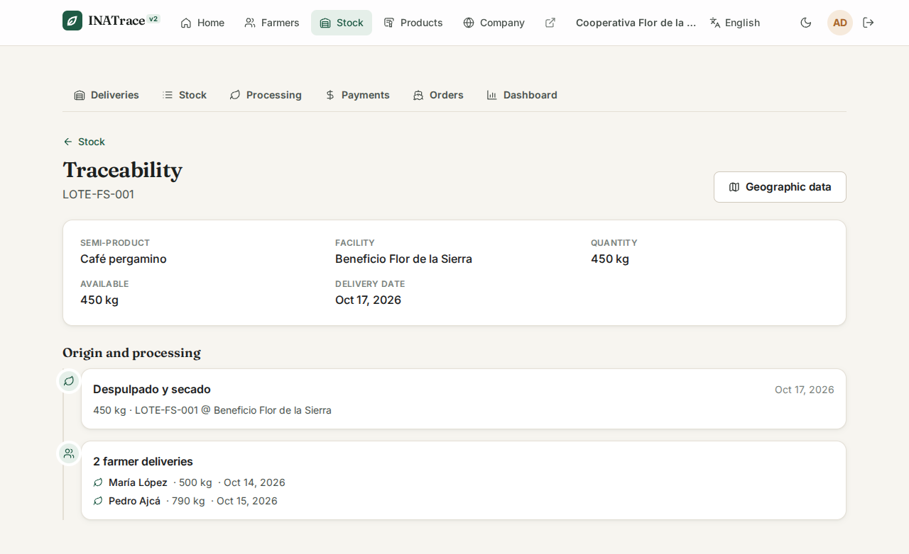<br><sub><b>Traceability</b>: where a batch comes from, with its processes and source deliveries.</sub></td>
  </tr>
  <tr>
    <td>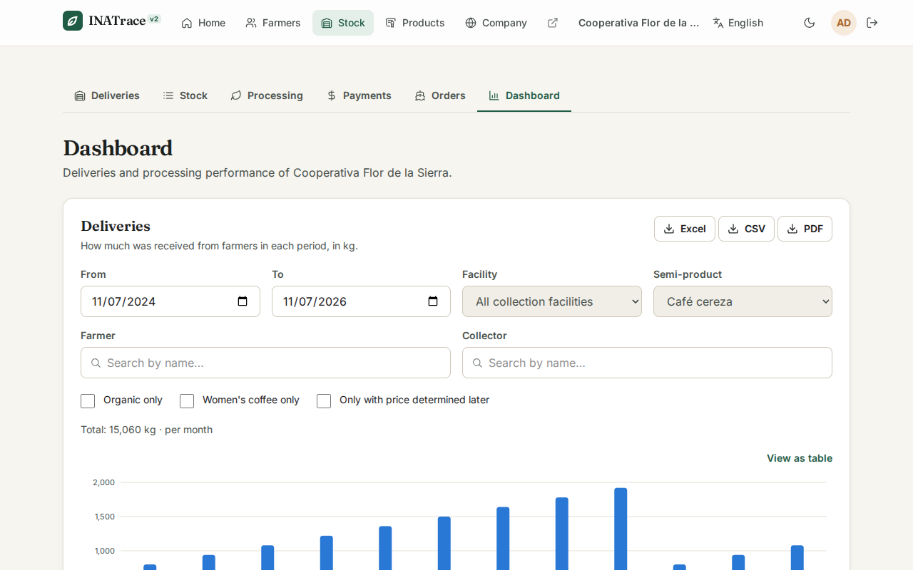<br><sub><b>Dashboard</b>: deliveries and processing yield by period, with a table view and export.</sub></td>
    <td>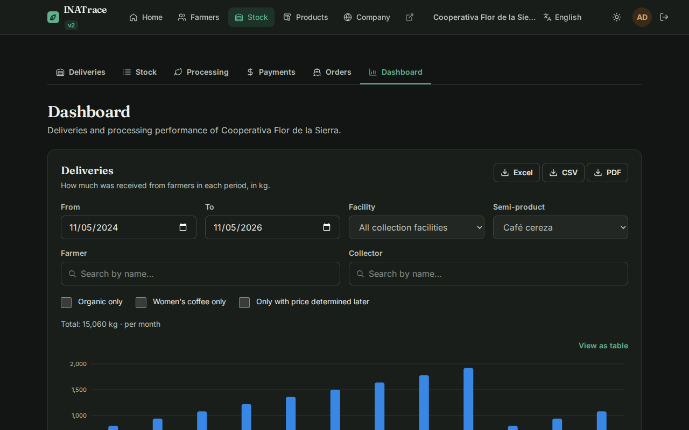<br><sub><b>Dark mode</b>: across the whole interface, with chart colors validated in both themes.</sub></td>
  </tr>
  <tr>
    <td>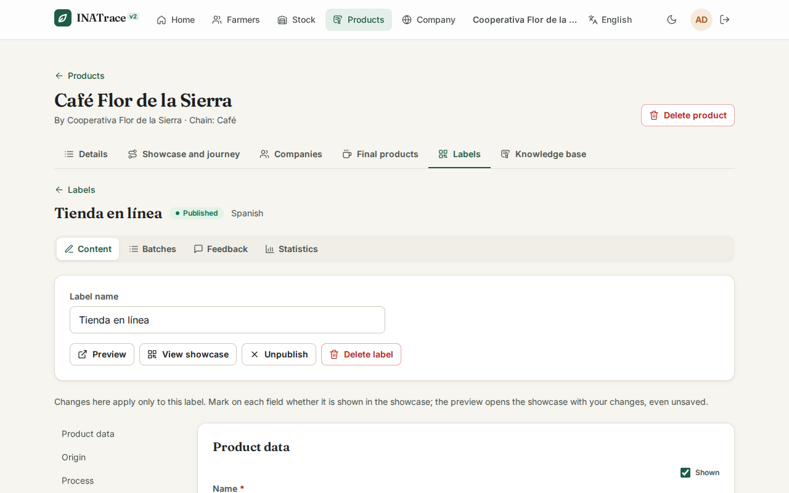<br><sub><b>Labels</b>: what the public page shows, field by field, plus preview, batches, feedback and statistics.</sub></td>
    <td>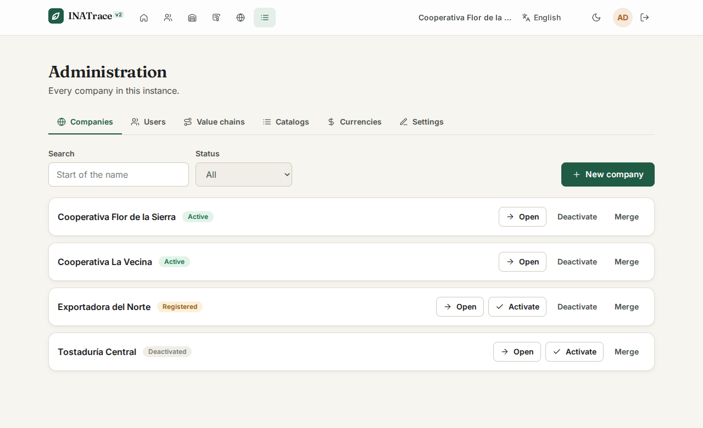<br><sub><b>Administration</b>: the instance's companies, users and value chains, depending on the role.</sub></td>
  </tr>
</table>

<table>
  <tr>
    <td width="33%" align="center">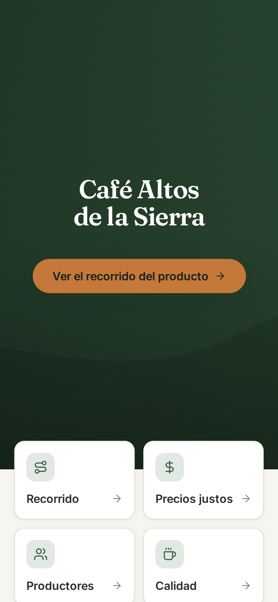<br><sub><b>Public product page</b> opened by the printed QR code, on a phone.</sub></td>
    <td width="33%" align="center">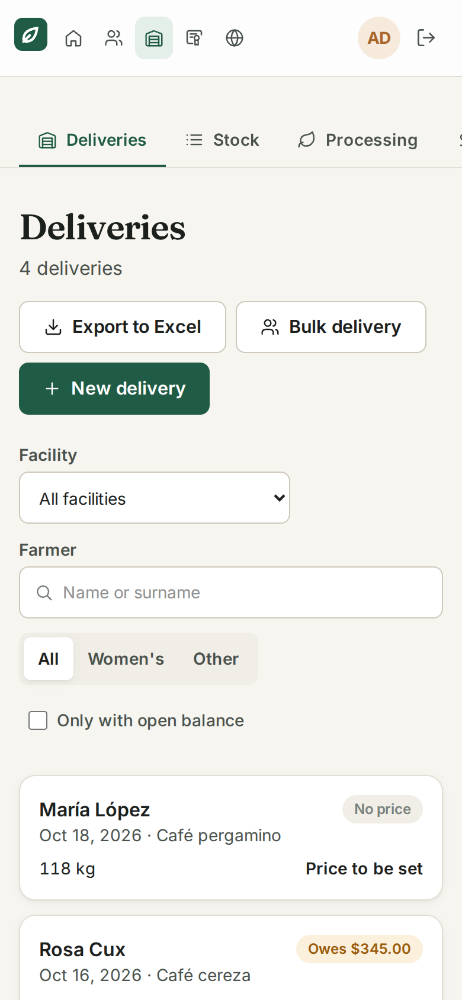<br><sub><b>Deliveries on a phone</b>: tables become cards.</sub></td>
    <td width="34%" valign="top">
      <b>Built for phones</b><br><br>
      Every screen is also tested at phone width (390 px). An automated test visits <b>every</b>
      screen and fails if any of them becomes wider than the window.
    </td>
  </tr>
</table>

## What changes from the current interface

| | Current interface (v1) | INATrace v2 |
|---|---|---|
| **Technical base** | Angular 10 + Node 14, out of support with no security updates | React 19, Vite 8 and TypeScript 6, all currently supported |
| **API client** | Generated, but out of date with the backend (obsolete and missing operations) | Regenerated from the running backend's OpenAPI spec: an API change breaks the build, not the screen |
| **Design** | The original design | New design system, mobile first, with light and dark modes |
| **Maps** | Mapbox (needs a token) | MapLibre, with catalog layers, plot drawing and computed area, no token |
| **Errors** | Generic messages in several cases | The cause is explained in the interface language (for example, why something cannot be deleted) |
| **Public product page (QR)** | Part of the full application | Loads on its own, without forms or editing maps, with the same URLs and the same visit tracking |
| **Permissions** | Some rules are only enforced on screen (H29) | Each role is respected in the interface, and the backend fix was proposed upstream ([#129](https://github.com/agstack/inatrace-backend/pull/129)) |

## Status by module

| Module | Status |
|---|---|
| Foundations: shared session, API client, design, languages, CI | ✅ |
| Public product page (QR) | ✅ |
| Farmers, collectors and plots | ✅ |
| Stock: deliveries, processing, payments, orders, traceability, dashboard and Beyco | ✅ (Beyco not yet tested against a real account) |
| Products, labels, batches, feedback, statistics and knowledge base | ✅ |
| Company: profile, users, facilities, processing actions and customers | ✅ |
| Administration: companies, users and value chains | ✅ |
| System catalogs and settings (types, currencies, settings, map layers, certifications, conversion factors) | ✅ |
| Account: sign-in, sign-up, email confirmation and password reset | ✅ |
| Enable the public page on a real installation (phase 1b) | ⏳ awaiting a decision |
| Retire the Angular interface (phase 6) | ⏳ last |

## Features

<details open>
<summary><b>Public product page (what people see when they scan the QR code)</b></summary>

- Product home, journey on the map, fair prices, farmers, quality and certificates.
- Feedback form with explicit consent.
- Terms and privacy policy.
- Same URLs as the current version (`/q-cd/{label}/{qr}`), and every visit is counted in the label
  statistics.
- Four languages and a mobile design.

</details>

<details>
<summary><b>Farmers, collectors and plots</b></summary>

- List with search, sorting and paging, or a map view with counts and catalog layers.
- Full profile: personal details, farm, crops, organizations, bank details and certifications.
- Plots drawn on the map (Terra Draw) with computed area, and a warning when the drawn area differs a
  lot from the declared one.
- Printable farmer card with a QR code.
- Import from an Excel spreadsheet and data export.
- Collectors (aggregators) use the same profile, without farm or plots.

</details>

<details>
<summary><b>Stock</b></summary>

- **Deliveries**: single and bulk, with filters (facility, farmer, semi-product, women's coffee,
  outstanding balance) and export.
- **All stock**: flat or grouped by facility.
- **Processing**: processes with evidence, fields and a QR code for the resulting batch.
- **Payments**: single and bulk, for deliveries and orders, with receipts.
- **Orders between companies and customer orders**: placed, received and approval.
- **Traceability**: where each batch comes from, back to the farmers' deliveries.
- **Dashboard**: deliveries and processing yield by period, drawn as our own SVG charts with tooltip,
  legend and table; export to Excel, CSV and PDF.
- **Beyco**: market offers from batches (optional integration).

</details>

<details>
<summary><b>Products and labels</b></summary>

- Product profile, public page and journey, supply chain companies and final products.
- Labels with field-by-field visibility, publishing, preview without saving, and QR codes.
- Batches, consumer feedback (with export) and visit statistics.
- Knowledge base per product, with topics, documents and videos.

</details>

<details>
<summary><b>Company</b></summary>

- Company profile: details, logo, certifications, videos, currency and value chains.
- Company users with their roles; a company is never left without an administrator.
- Facilities with type, location on the map, value chains and semi-products.
- Processing actions with their evidence and fields.
- Company customers.

</details>

<details>
<summary><b>System administration</b> (system and regional administrators only)</summary>

- **Companies**: search, create, activate, deactivate, merge, and open any company to work in it.
- **Users**: confirm email, activate, deactivate and change role, plus a profile for each person
  listing their companies.
- **Value chains**: create and edit with their configuration (facility types, units, evidence types,
  fields and semi-products), activate, deactivate and delete.
- **Catalogs**: semi-products, product, facility and evidence types, measuring units, evidence fields (with
  translations), map layers, certification types and conversion factors.
- Active **currencies** and instance **settings** (the text shown when a QR code points to an unpublished
  label, and a help link for labels).
- Regional administrators only see their own companies and can only do what their role allows.

</details>

<details>
<summary><b>Account</b></summary>

- Sign-in, sign-up with acceptance of the conditions, email confirmation through the link received, and
  password reset.
- Email links use the same routes as the current version (`/confirm-email/…`, `/reset-password/…`), under `/v2`.
- Asking for a reset link does not reveal whether the email has an account.

</details>

## Architecture

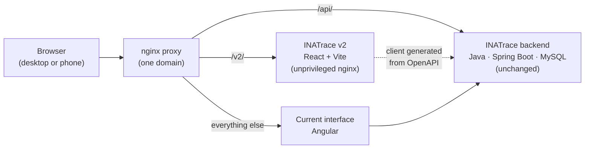

- **Side by side:** the proxy (`deploy/convivencia/`) sends `/v2/` to this interface, `/api/` to the
  backend and everything else to the current interface. Both share the same session cookie.
- **QR codes already printed:** the proxy can redirect `/{language}/q-cd/…` to the v2 public page. The
  rule is ready but commented out; it is enabled in phase 1b and can be rolled back instantly.
- **Data:** TanStack Query handles caching and refetching. Forms always edit the complete, fresh
  record from the backend, because the backend replaces every field on save.
- **Routing:** TanStack Router defines routes in code, with validated search parameters in the URL
  and screens loaded on demand.
- **Language:** every request sends the `language` header, like the current interface, and the
  backend translates with it.

## Technology

| Area | Technology |
|---|---|
| UI | React 19, TypeScript 6 |
| Build | Vite 8 |
| Routing and data | TanStack Router, TanStack Query |
| Forms | React Hook Form + Zod |
| Styling | Tailwind CSS 4 with our own tokens (light and dark); Inter and Fraunces typefaces |
| Maps | MapLibre GL 6 and Terra Draw (plot drawing) |
| Languages | i18next: Spanish, English, German and Kinyarwanda |
| API client | `@hey-api/openapi-ts`, generated from the backend's OpenAPI spec |
| QR codes | `uqr` |
| Safe HTML | DOMPurify |
| Mock mode | MSW (Mock Service Worker) |
| Tests | Vitest + Testing Library; Playwright |
| Delivery | Docker: Node 24 build stage and unprivileged nginx; image on GHCR |
| Packages | pnpm 9 |

## Repository layout

Folder and file names are in Spanish, like the rest of the code.

```text
inatrace-v2/
├── src/
│   ├── api/            # queries and mutations by area (TanStack Query) + gen/ (generated client)
│   ├── componentes/    # shared UI: ui/, mapa/ (maps), graficos/ (charts), selectors
│   ├── paginas/        # screens by module: vitrina (public page), productores (farmers), stock,
│   │                   #   productos (products), empresa (company), administracion, portal, acceso (sign-in)
│   ├── util/           # pure logic with unit tests (building records, validation, permissions)
│   ├── i18n/           # setup and texts (es, en, de, rw)
│   ├── mocks/          # mock mode: MSW handlers and fictitious data
│   ├── estilos/        # design tokens and base styles
│   └── rutas.tsx       # route tree
├── e2e/                # end-to-end tests with mock data (desktop and mobile)
├── e2e-real/           # tests against a real installation (see e2e-real/README.md)
├── deploy/
│   ├── nginx/          # container configuration (CSP, runtime config)
│   └── convivencia/    # proxy + compose to run next to the current interface
├── scripts/            # update the API client, import translations, seed demos, screenshots
├── docs/               # PLAN.md, AVANCE.md, credits and screenshots
└── public/config.js    # configuration read at runtime (not at build time)
```

## Getting started

**Requirements:** Node 24 and pnpm 9. For end-to-end tests, Playwright's Chromium.

```bash
pnpm install

# No backend: MSW answers with sample data
pnpm dev:simulado
#   → http://localhost:5173/v2/          (sign in: demo@inatrace.local / demo1234)
#   → http://localhost:5173/v2/p-cd/demo/QR-DEMO-2026   (public product page)

# Against a real backend (see .env.ejemplo)
cp .env.ejemplo .env
pnpm dev
```

In mock mode you can try the interface with another role by setting `simulado.rol` in
`sessionStorage` to `SYSTEM_ADMIN` or `REGIONAL_ADMIN` from the browser console.

## Configuration

**Development** (`.env`):

| Variable | Purpose |
|---|---|
| `INATRACE_API` | Backend that Vite proxies `/api` to (default `http://localhost:8081`) |
| `VITE_URL_ANTERIOR` | URL of the current interface, for the "Open in the current version" links |

**Container** (environment variables read **at startup**, so one image serves any installation):

| Variable | Purpose |
|---|---|
| `TOKEN_REGISTRO_PUBLICO` | Must match the backend's `INATrace.requestLog.token`; records QR visits |
| `APP_BASE_URL` | Public root of the QR codes (empty: the page's origin) |
| `QR_CODE_BASE_PATH` | Path of the printed QR codes (default `q-cd`) |
| `BEYCO_AUTH_URL`, `BEYCO_CLIENT_ID` | Beyco integration (empty: no Beyco) |

## Scripts

| Script | What it does |
|---|---|
| `pnpm dev` | Development server against a real backend |
| `pnpm dev:simulado` | Development server with mock data (MSW) |
| `pnpm build` | Type-check and production build |
| `pnpm lint` | Type check (`tsc -b`) |
| `pnpm test` | Unit tests (Vitest) |
| `pnpm e2e` | End-to-end tests in mock mode (Playwright) |
| `pnpm api:actualizar` | Download the backend's OpenAPI spec (`INATRACE_API`) and regenerate the typed client |
| `pnpm i18n:importar` | Reuse the current interface's translations (German and Kinyarwanda) |
| `pnpm capturas` | Regenerate the README screenshots (with `pnpm dev:simulado --port 5199` running; `CAPTURAS_IDIOMA=en` for English) |

## Tests

Three levels, from fastest to closest to production (figures as of 6 November 2026):

| Level | Tool | Count | What it covers |
|---|---|---|---|
| Unit | Vitest | 163 | Pure logic: building records on top of the original, validation, role permissions, grouping |
| End-to-end, mocked | Playwright + MSW | 192 | Every flow on **desktop and phone**, plus a test that visits every screen looking for overflow |
| Against a real backend | Playwright | 42 | The same flows against an isolated copy of INATrace, checking what was saved through the API |

```bash
pnpm lint && pnpm test && pnpm e2e

# Against a real installation (see e2e-real/README.md for the variables)
INATRACE_URL=http://localhost:5181 INATRACE_USUARIO=… INATRACE_CLAVE=… \
  pnpm exec playwright test -c playwright.real.config.ts
```

CI (GitHub Actions) runs the type check, unit tests and end-to-end tests on every push to `main` and
to the `fase-*` branches, and on every pull request. From `main` it also publishes the image.

## Deployment

- **Image:** `ghcr.io/reiterstahl/inatrace-v2` (tags `latest` and the commit SHA), published by CI
  from `main` when every test passes. It is unprivileged nginx on port **8080**, with security headers
  and a strict CSP.
- **Side by side:** `deploy/convivencia/` provides the proxy and a `docker-compose.yml` to put v2 in
  front of an existing installation without touching it.
- **Demo data** (test instances only):
  - `scripts/sembrar-demo.mjs`: a "generate QR" action, a batch with a QR code and a published label.
  - `scripts/sembrar-medios.mjs`: openly licensed photos and a video; credits are in
    [docs/CREDITOS-DEMO.md](docs/CREDITOS-DEMO.md).
  - Other `scripts/sembrar-*.mjs` seed processing, orders, currencies and products.

## Security

- **Strict CSP** (`script-src 'self'`) and security headers in the container's nginx, which runs
  unprivileged.
- **User-supplied HTML is sanitized** with DOMPurify before it is shown.
- **No secrets in the build:** each installation's configuration is injected at startup.
- **Role permissions in the interface:** v2 does not offer actions a role should not have, even when
  the backend accepts them.
- **Private documents and images** are fetched through authenticated routes, not public links.

## Contributions to the original project

Building v2 against the real backend surfaced bugs in the INATrace backend. They were fixed and sent
as pull requests to [agstack/inatrace-backend](https://github.com/agstack/inatrace-backend), each with
a regression test:

| PR | What it fixes | Status |
|---|---|---|
| [#112](https://github.com/agstack/inatrace-backend/pull/112), [#113](https://github.com/agstack/inatrace-backend/pull/113) | Payment receipts, and the transaction when deleting a delivery | ✅ merged |
| [#116](https://github.com/agstack/inatrace-backend/pull/116) | Copying a product to a label lost labor policies and origin locations | ✅ merged |
| [#117](https://github.com/agstack/inatrace-backend/pull/117) | A product with a knowledge base could not be deleted | ✅ merged |
| [#118](https://github.com/agstack/inatrace-backend/pull/118) | The company manager was never saved | ✅ merged |
| [#119](https://github.com/agstack/inatrace-backend/pull/119) + [frontend #33](https://github.com/agstack/inatrace-frontend/pull/33) | The public feedback list exposed consumers' personal data | ✅ merged / approved |
| [#122](https://github.com/agstack/inatrace-backend/pull/122), [#123](https://github.com/agstack/inatrace-backend/pull/123) | 500 errors when deleting processing actions or customers in use | ✅ merged |
| [#129](https://github.com/agstack/inatrace-backend/pull/129) | Regional administrators could grant the system administrator role | 🕓 in review |
| [#132](https://github.com/agstack/inatrace-backend/pull/132) | 500 error when deleting a value chain in use | 🕓 in review |
| [#137](https://github.com/agstack/inatrace-backend/pull/137) | 500 error when deleting codebook entries in use | 🕓 in review |

## Technical decisions

- **TypeScript 6, not 7:** the client generator uses the compiler's JavaScript API.
- **MapLibre 6 needs its worker URL set explicitly** (`setWorkerUrl`); without it the map stays blank.
- **Public page URLs are the same** as in the current version, under `/v2`, so printed QR codes keep
  working.
- **Records are saved on top of the original:** the backend replaces every field on update, so each
  screen edits the complete, freshly read record and sends complete catalog objects.
- **Our own SVG charts,** with no charting library: bars with tooltip, legend, table view and colors
  validated for color blindness in both themes.

## Documentation

These documents are in Spanish.

- [docs/PLAN.md](docs/PLAN.md): what v2 is and is not, principles, architecture, inventory of the
  current interface, phases and risks.
- [docs/AVANCE.md](docs/AVANCE.md): what was done in each phase, with its tests, findings and open items.
- [e2e-real/README.md](e2e-real/README.md): how to run the tests against a real installation.

## License and credits

**Mozilla Public License 2.0** ([LICENSE](LICENSE)), the same as INATrace. INATrace v2 reinterprets
its interface: the code is new, but some parts derive from the original frontend (the "Fair prices"
calculation and the German and Kinyarwanda translations, imported from its language files) and are
distributed under the same terms. INATrace is a project of GIZ and its contributors, now maintained
at [AgStack](https://github.com/agstack).

The demo photos have their own licenses: see [docs/CREDITOS-DEMO.md](docs/CREDITOS-DEMO.md).
