<div align="center">

# INATrace v2

**Español** · [English](README.en.md)

**Interfaz nueva para [INATrace](https://github.com/agstack/inatrace-backend), la plataforma abierta de trazabilidad de cadenas agrícolas, construida sobre el backend existente y sin cambiarlo.**

[](https://github.com/reiterstahl/inatrace-v2/actions/workflows/ci.yml)


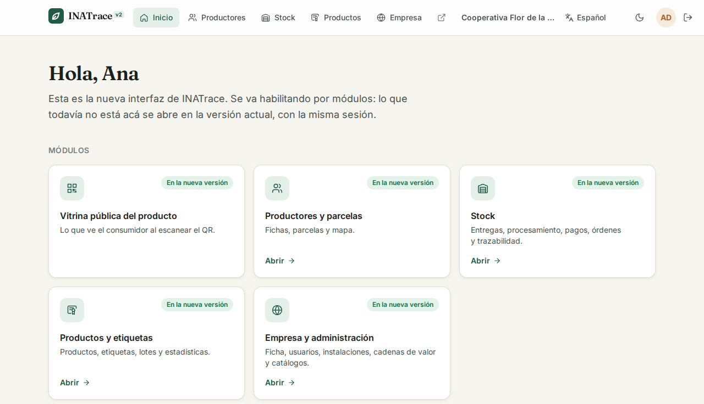

</div>

---

## Índice

- [Qué es](#qué-es)
- [Vistas previas](#vistas-previas)
- [Qué cambia respecto a la interfaz actual](#qué-cambia-respecto-a-la-interfaz-actual) · [antes y después, con capturas](docs/ANTES-Y-DESPUES.md)
- [Estado por módulo](#estado-por-módulo)
- [Funcionalidades](#funcionalidades)
- [Arquitectura](#arquitectura)
- [Tecnologías](#tecnologías)
- [Estructura del repositorio](#estructura-del-repositorio)
- [Empezar](#empezar)
- [Configuración](#configuración)
- [Scripts](#scripts)
- [Pruebas](#pruebas)
- [Despliegue](#despliegue)
- [Seguridad](#seguridad)
- [Contribuciones al proyecto original](#contribuciones-al-proyecto-original)
- [Decisiones técnicas](#decisiones-técnicas)
- [Documentación](#documentación)
- [Licencia y créditos](#licencia-y-créditos)

---

## Qué es

INATrace v2 reemplaza, módulo por módulo, la interfaz web de INATrace (Angular 10) por una nueva en
React. Habla con el **mismo backend Java/Spring sin modificarlo** y **convive** con la interfaz
actual: un proxy reparte las rutas en un mismo dominio, así que la sesión es una sola y se puede
pasar de una versión a otra sin volver a ingresar. Lo que todavía no está en la v2 se abre en la
versión actual.

Es una iniciativa propia de Rolando Quirós, separada de los contratos con la GIZ. El plan completo
está en [docs/PLAN.md](docs/PLAN.md) y el estado detallado, fase por fase, en
[docs/AVANCE.md](docs/AVANCE.md).

## Vistas previas

> Capturas del **modo simulado** (datos ficticios, sin backend). Se regeneran con `pnpm capturas`.

<table>
  <tr>
    <td width="50%">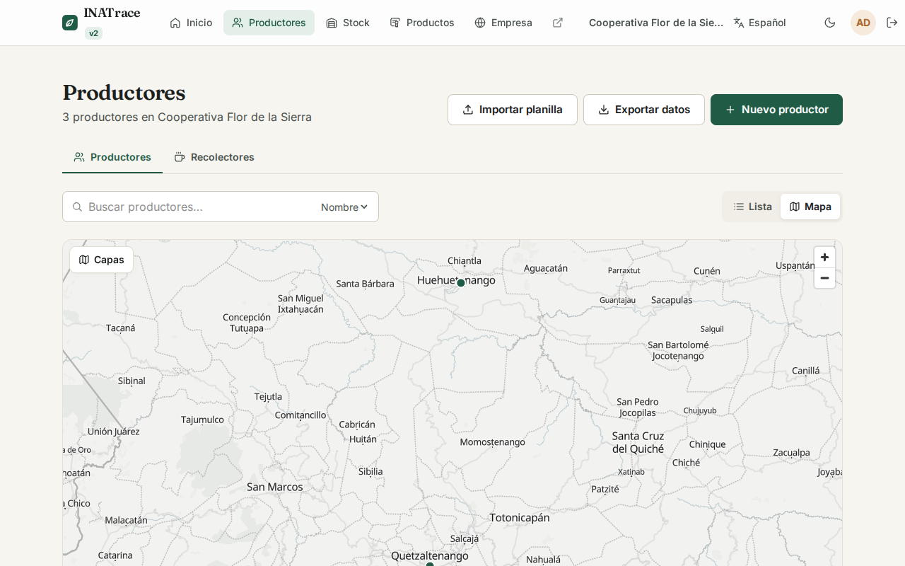<br><sub><b>Productores en el mapa</b>: lista o mapa con capas del catálogo, sin token de Mapbox.</sub></td>
    <td width="50%">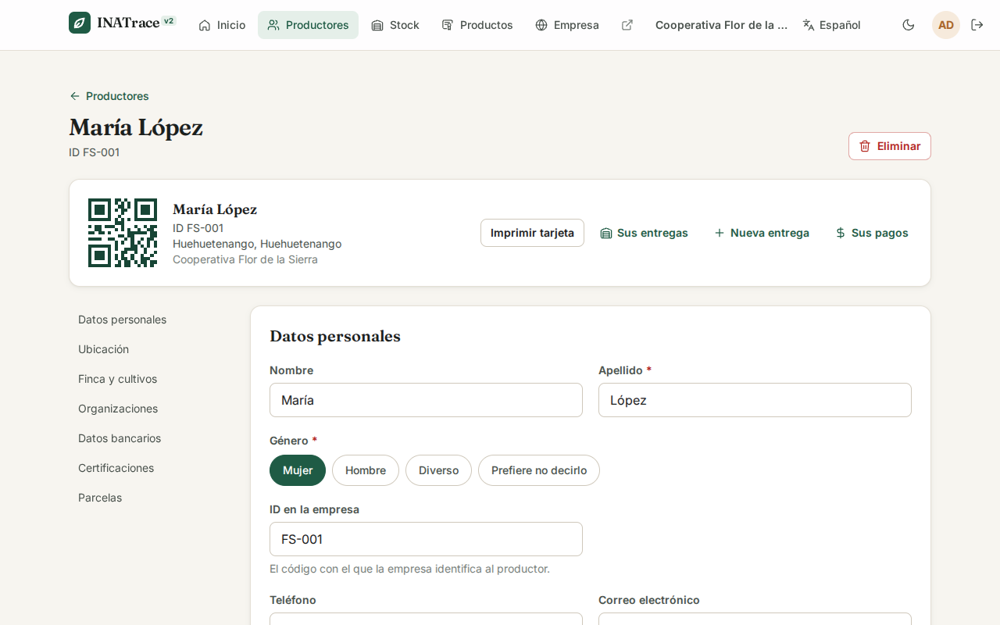<br><sub><b>Ficha del productor</b>: datos personales, finca, parcelas, tarjeta con QR, entregas y pagos.</sub></td>
  </tr>
  <tr>
    <td>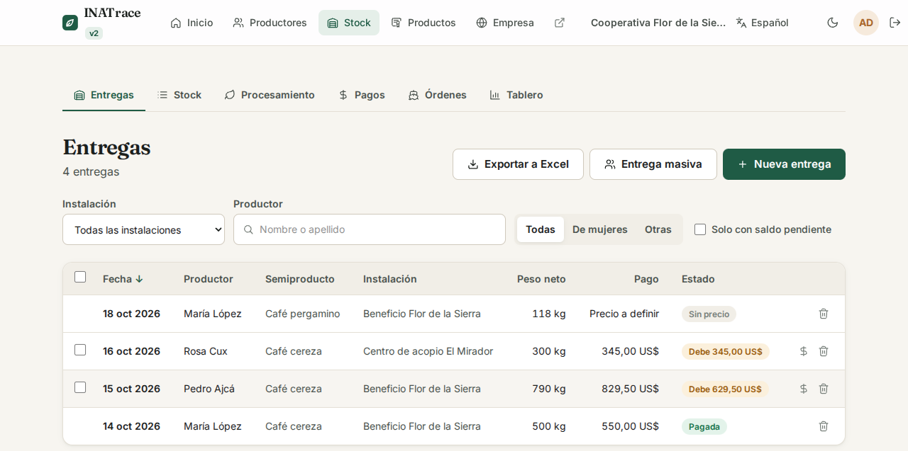<br><sub><b>Entregas</b>: filtros, saldo pendiente, entrega masiva y exportación a Excel.</sub></td>
    <td>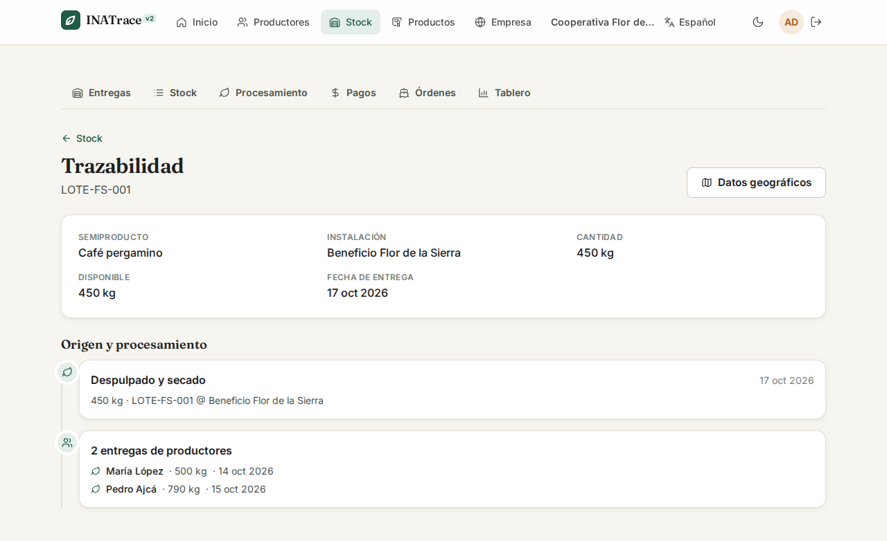<br><sub><b>Trazabilidad</b>: de dónde viene un lote, con sus procesos y entregas de origen.</sub></td>
  </tr>
  <tr>
    <td>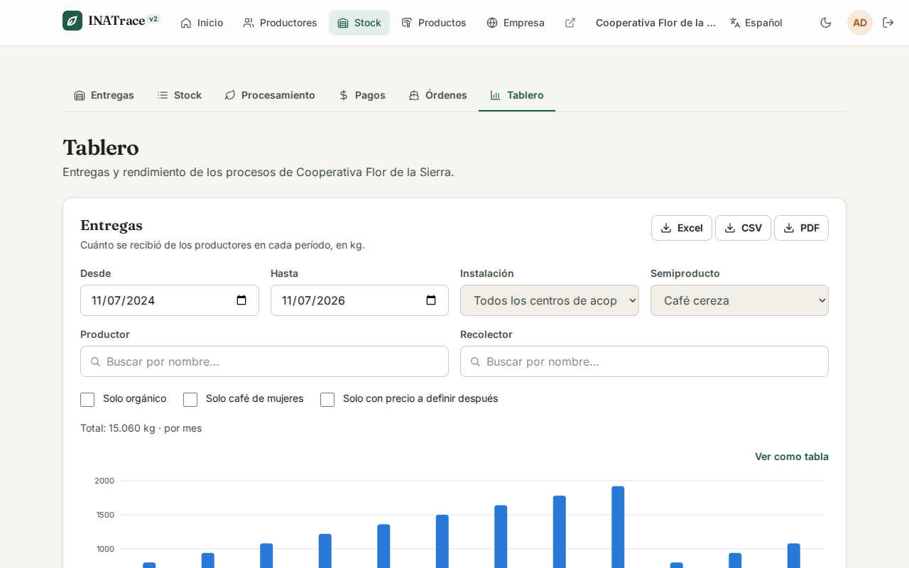<br><sub><b>Tablero</b>: entregas y rendimiento por período, con vista de tabla y exportación.</sub></td>
    <td>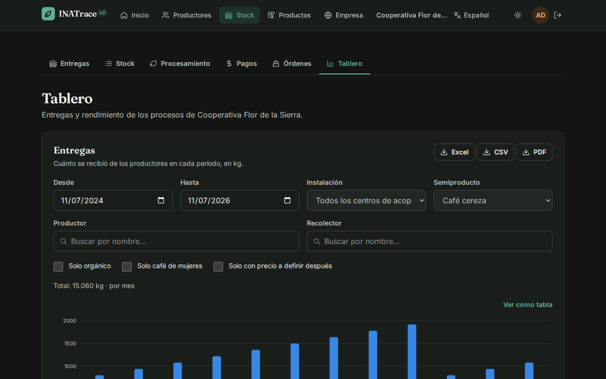<br><sub><b>Modo oscuro</b>: toda la interfaz, con colores de gráficos validados en los dos temas.</sub></td>
  </tr>
  <tr>
    <td>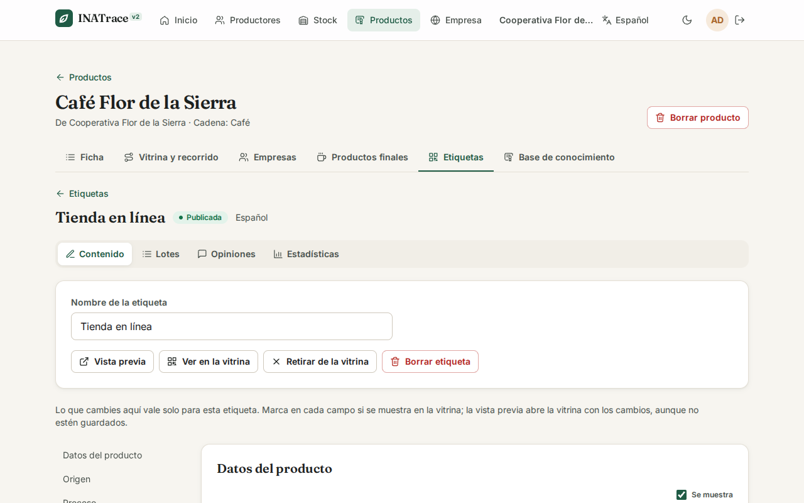<br><sub><b>Etiquetas</b>: qué se muestra en la vitrina campo por campo, vista previa, lotes, opiniones y estadísticas.</sub></td>
    <td>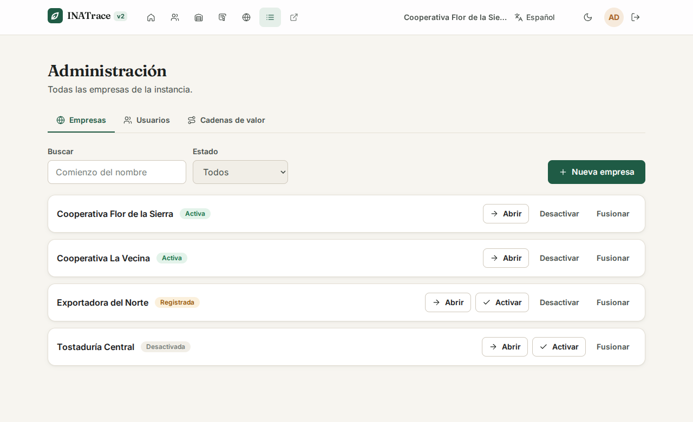<br><sub><b>Administración</b>: empresas, usuarios y cadenas de valor de la instancia, según el rol.</sub></td>
  </tr>
</table>

<table>
  <tr>
    <td width="33%" align="center">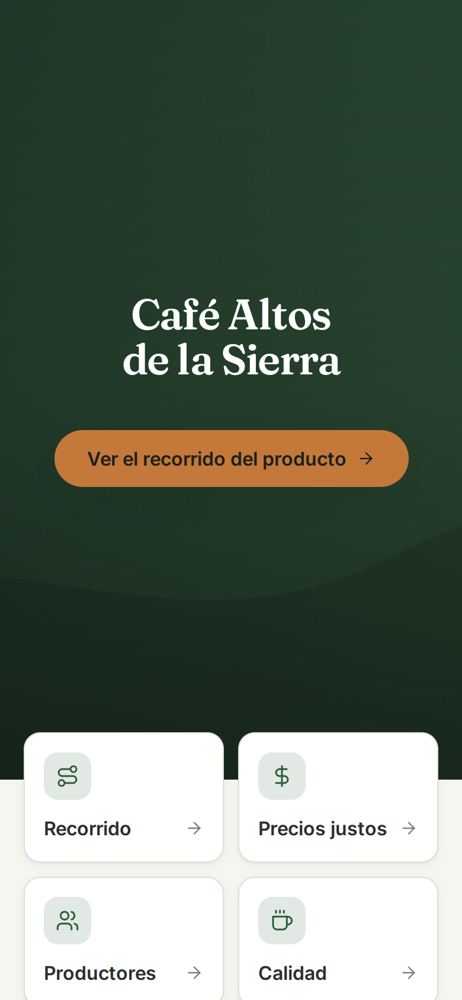<br><sub><b>Vitrina pública</b> que abre el QR impreso, en el celular.</sub></td>
    <td width="33%" align="center">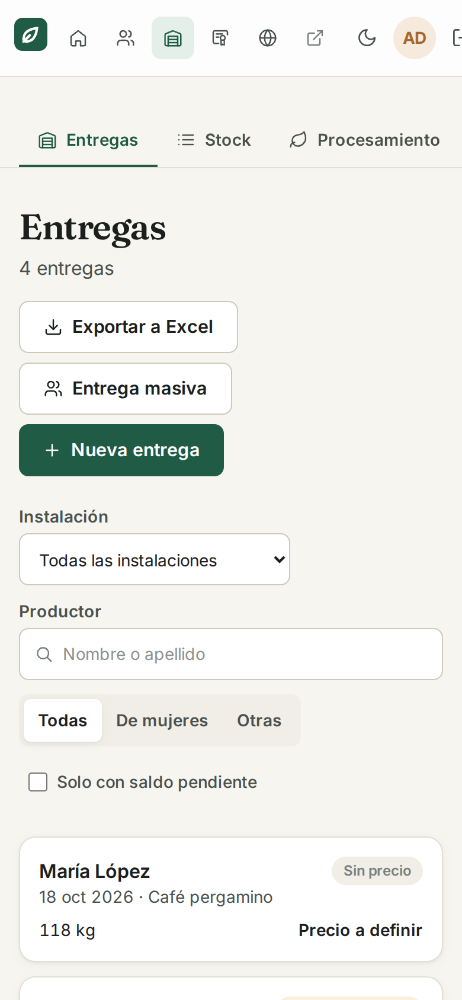<br><sub><b>Entregas en el celular</b>: las tablas pasan a tarjetas.</sub></td>
    <td width="34%" valign="top">
      <b>Pensada para el celular</b><br><br>
      Cada pantalla se prueba también con el ancho de un teléfono (390 px). Una prueba automática
      recorre <b>todas</b> las pantallas y falla si alguna queda más ancha que la ventana.
    </td>
  </tr>
</table>

## Qué cambia respecto a la interfaz actual

> 📸 **[Antes y después](docs/ANTES-Y-DESPUES.md):** las mismas pantallas, con los mismos datos, en la interfaz
> actual y en la v2. En el celular, la vitrina pública baja **un 82 % menos** (1 089 KB contra 5 975 KB) y
> **un 87 % menos de JavaScript**.

| | Interfaz actual (v1) | INATrace v2 |
|---|---|---|
| **Base técnica** | Angular 10 + Node 14, sin soporte ni parches de seguridad | React 19, Vite 8 y TypeScript 6, con soporte vigente |
| **Cliente de la API** | Generado, pero desfasado del backend (operaciones obsoletas y faltantes) | Se regenera desde el OpenAPI del backend en uso: un cambio en la API rompe la compilación, no la pantalla |
| **Diseño** | El diseño original | Sistema de diseño nuevo, pensado primero para el celular, con modo claro y oscuro |
| **Mapas** | Mapbox (requiere token) | MapLibre, con capas del catálogo, dibujo de parcelas y superficie calculada, sin token |
| **Errores** | Mensajes genéricos en varios casos | Se explica la causa en el idioma de la interfaz (por ejemplo, por qué algo no se puede borrar) |
| **Vitrina pública (QR)** | Parte de la aplicación completa | Se carga sola, sin formularios ni mapas de edición, con las mismas URL y el mismo registro de visitas |
| **Permisos** | Algunas reglas solo se aplican en la pantalla (H29) | Respeta cada rol en la interfaz, y la corrección del backend se propuso al original ([#129](https://github.com/agstack/inatrace-backend/pull/129)) |

## Estado por módulo

| Módulo | Estado |
|---|---|
| Cimientos: sesión compartida, cliente de API, diseño, idiomas, CI | ✅ |
| Vitrina pública del producto (QR) | ✅ |
| Productores, recolectores y parcelas | ✅ |
| Stock: entregas, procesamiento, pagos, órdenes, trazabilidad, tablero y Beyco | ✅ (Beyco sin probar contra una cuenta real) |
| Productos, etiquetas, lotes, opiniones, estadísticas y base de conocimiento | ✅ |
| Empresa: ficha, usuarios, instalaciones, acciones de procesamiento y clientes | ✅ |
| Administración: empresas, usuarios y cadenas de valor | ✅ |
| Catálogos y ajustes del sistema (tipos, monedas, ajustes, capas de mapa, certificaciones, factores de conversión) | ✅ |
| Cuenta: ingreso, registro, confirmación de correo y restablecer contraseña | ✅ |
| Activar la vitrina en una instalación (fase 1b) | ✅ en la instalación local de demostración |
| Retiro de la interfaz Angular (fase 6) | ✅ en la instalación local de demostración |

## Funcionalidades

<details open>
<summary><b>Vitrina pública (lo que ve quien escanea el QR)</b></summary>

- Portada del producto, recorrido en el mapa, precios justos, productores, calidad y certificados.
- Formulario de opinión con consentimiento explícito.
- Términos y política de privacidad.
- Mismas URL que la versión actual (`/q-cd/{etiqueta}/{qr}`) y registro de cada visita en las
  estadísticas de la etiqueta.
- Cuatro idiomas y diseño para el celular.

</details>

<details>
<summary><b>Productores, recolectores y parcelas</b></summary>

- Lista con búsqueda, orden y páginas, o vista de mapa con conteos y capas del catálogo.
- Ficha completa: datos personales, finca, cultivos, organizaciones, datos bancarios y
  certificaciones.
- Parcelas dibujadas sobre el mapa (Terra Draw), con superficie calculada y aviso si se aparta
  mucho de la declarada.
- Tarjeta imprimible con QR del productor.
- Importación desde planilla Excel y exportación de datos.
- Recolectores (acopiadores) con la misma ficha, sin finca ni parcelas.

</details>

<details>
<summary><b>Stock</b></summary>

- **Entregas**: individuales y masivas, filtros (instalación, productor, semiproducto, café de
  mujeres, saldo pendiente) y exportación.
- **Todo el stock**: vista suelta o agrupada por instalación.
- **Procesamiento**: procesos con evidencias, campos y QR del lote resultante.
- **Pagos**: individuales y masivos, a entregas y a órdenes, con comprobantes.
- **Órdenes entre empresas y pedidos de clientes**: emitidas, recibidas y aprobación.
- **Trazabilidad**: el origen de cada lote, hasta las entregas de los productores.
- **Tablero**: entregas y rendimiento del procesamiento por período, en gráficos SVG propios con
  tooltip, leyenda y tabla; exportación a Excel, CSV y PDF.
- **Beyco**: ofertas al mercado desde los lotes (integración opcional).

</details>

<details>
<summary><b>Productos y etiquetas</b></summary>

- Ficha del producto, vitrina y recorrido, empresas de la cadena y productos finales.
- Etiquetas con visibilidad campo por campo, publicación, vista previa sin guardar y QR.
- Lotes, opiniones de consumidores (con exportación) y estadísticas de visitas.
- Base de conocimiento por producto, con temas, documentos y videos.

</details>

<details>
<summary><b>Empresa</b></summary>

- Ficha de la empresa: datos, logo, certificaciones, videos, moneda y cadenas de valor.
- Usuarios de la empresa con su rol, sin dejarla nunca sin administración.
- Instalaciones con su tipo, ubicación en el mapa, cadenas y semiproductos.
- Acciones de procesamiento con sus evidencias y campos.
- Clientes de la empresa.

</details>

<details>
<summary><b>Administración del sistema</b> (solo administración del sistema y regional)</summary>

- **Empresas**: buscar, crear, activar, desactivar, fusionar y abrir cualquiera para trabajar con ella.
- **Usuarios**: confirmar el correo, activar, desactivar y cambiar el rol, más la ficha de cada
  persona con sus empresas.
- **Cadenas de valor**: crear y editar con su configuración (tipos de instalación, unidades,
  evidencias, campos y semiproductos), activar, desactivar y borrar.
- **Catálogos**: semiproductos, tipos de producto, de instalación, unidades, tipos y campos de evidencia
  (con traducciones), capas de mapa, tipos de certificación y factores de conversión.
- **Monedas** activas y **ajustes** de la instancia (el texto que ve quien escanea un QR de una etiqueta
  sin publicar y un enlace de ayuda para las etiquetas).
- La administración regional solo ve lo suyo y solo puede hacer lo que le corresponde.

</details>

<details>
<summary><b>Cuenta</b></summary>

- Ingreso, registro con aceptación de condiciones, confirmación del correo con el enlace recibido y
  restablecimiento de la contraseña.
- Los enlaces de los correos usan las mismas rutas que la versión actual (`/confirm-email/…`,
  `/reset-password/…`), bajo `/v2`.
- Pedir un enlace para restablecer no revela si el correo tiene cuenta.

</details>

## Arquitectura

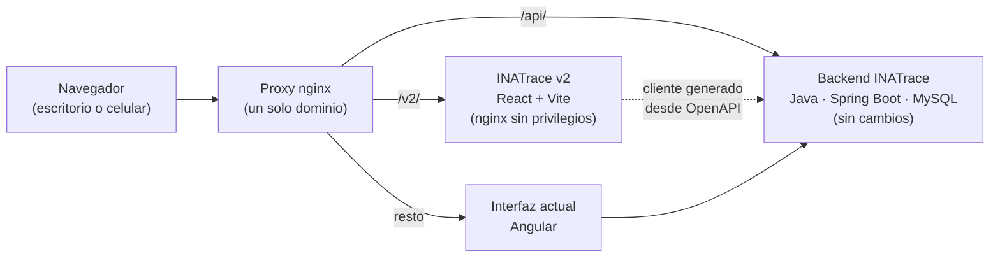

- **Convivencia:** el proxy (`deploy/convivencia/`) manda `/v2/` a esta interfaz, `/api/` al
  backend y el resto a la interfaz actual. La cookie de sesión es la misma para las dos.
- **QR ya impresos:** con `QR_A_V2=si` el proxy redirige `/{idioma}/q-cd/…` a la vitrina de la v2;
  con `no` siguen en la interfaz actual. Activar o volver atrás es cambiar la variable y reiniciar el proxy.
- **Retiro de Angular:** con `ANGULAR=no` el proxy deja de enviar tráfico a la interfaz actual y cada ruta
  vieja redirige a su equivalente en la v2 (74 reglas, con o sin idioma delante).
- **Datos:** TanStack Query maneja la caché y las recargas. Las fichas se editan siempre sobre la
  versión completa y fresca del backend, porque este reemplaza todos los campos al guardar.
- **Rutas:** TanStack Router define las rutas en código, con búsqueda validada en la URL y
  pantallas que se cargan al entrar.
- **Idioma:** cada petición manda la cabecera `language`, igual que la interfaz actual, y el backend
  traduce con eso.

## Tecnologías

| Área | Tecnología |
|---|---|
| Interfaz | React 19, TypeScript 6 |
| Compilación | Vite 8 |
| Rutas y datos | TanStack Router, TanStack Query |
| Formularios | React Hook Form + Zod |
| Estilos | Tailwind CSS 4 con tokens propios (claro y oscuro); tipografías Inter y Fraunces |
| Mapas | MapLibre GL 6 y Terra Draw (dibujo de parcelas) |
| Idiomas | i18next: español, inglés, alemán y kinyarwanda |
| Cliente de API | `@hey-api/openapi-ts`, generado desde el OpenAPI del backend |
| QR | `uqr` |
| HTML seguro | DOMPurify |
| Modo simulado | MSW (Mock Service Worker) |
| Pruebas | Vitest + Testing Library; Playwright |
| Entrega | Docker: compilación con Node 24 y nginx sin privilegios; imagen en GHCR |
| Paquetes | pnpm 9 |

## Estructura del repositorio

```text
inatrace-v2/
├── src/
│   ├── api/            # consultas y mutaciones por área (TanStack Query) + gen/ (cliente generado)
│   ├── componentes/    # interfaz común: ui/, mapa/, graficos/, selectores
│   ├── paginas/        # pantallas por módulo: vitrina, productores, stock, productos,
│   │                   #   empresa, administracion, portal, acceso
│   ├── util/           # lógica pura con pruebas unitarias (armado de fichas, validaciones, permisos)
│   ├── i18n/           # configuración y textos (es, en, de, rw)
│   ├── mocks/          # modo simulado: manejadores MSW y datos ficticios
│   ├── estilos/        # tokens de diseño y estilos base
│   └── rutas.tsx       # árbol de rutas
├── e2e/                # pruebas de punta a punta con datos simulados (escritorio y celular)
├── e2e-real/           # pruebas contra una instalación real (ver e2e-real/README.md)
├── deploy/
│   ├── nginx/          # configuración del contenedor (CSP, config en tiempo de ejecución)
│   └── convivencia/    # proxy + compose para correr junto a la interfaz actual
├── scripts/            # actualizar el cliente, importar traducciones, sembrar demos, capturas
├── docs/               # PLAN.md, AVANCE.md, créditos y capturas
└── public/config.js    # configuración leída en tiempo de ejecución (no en el build)
```

## Empezar

**Requisitos:** Node 24 y pnpm 9. Para las pruebas de punta a punta, Chromium de Playwright.

```bash
pnpm install

# Sin backend: MSW responde con datos de ejemplo
pnpm dev:simulado
#   → http://localhost:5173/v2/          (ingreso: demo@inatrace.local / demo1234)
#   → http://localhost:5173/v2/p-cd/demo/QR-DEMO-2026   (vitrina pública)

# Contra un backend real (ver .env.ejemplo)
cp .env.ejemplo .env
pnpm dev
```

En modo simulado se puede probar la interfaz con otro rol guardando el rol en `sessionStorage`
(`simulado.rol` = `SYSTEM_ADMIN` o `REGIONAL_ADMIN`) desde la consola del navegador.

## Configuración

**Desarrollo** (`.env`):

| Variable | Para qué |
|---|---|
| `INATRACE_API` | Backend al que Vite redirige `/api` (por defecto `http://localhost:8081`) |
| `VITE_URL_ANTERIOR` | URL de la interfaz actual, para los enlaces «Versión actual» (vacío: no se muestran) |

**Contenedor** (variables de entorno, leídas **al arrancar**: la misma imagen sirve para cualquier
instalación):

| Variable | Para qué |
|---|---|
| `TOKEN_REGISTRO_PUBLICO` | Igual al `INATrace.requestLog.token` del backend; registra las visitas de los QR |
| `APP_BASE_URL` | Raíz pública de los QR (vacío: el origen de la página) |
| `QR_CODE_BASE_PATH` | Ruta de los QR impresos (por defecto `q-cd`) |
| `URL_ANTERIOR` | Raíz de la interfaz actual mientras conviven; vacío (por defecto) oculta los enlaces a ella |
| `BEYCO_AUTH_URL`, `BEYCO_CLIENT_ID` | Integración con Beyco (vacías: sin Beyco) |

## Scripts

| Script | Qué hace |
|---|---|
| `pnpm dev` | Servidor de desarrollo contra un backend real |
| `pnpm dev:simulado` | Servidor de desarrollo con datos simulados (MSW) |
| `pnpm build` | Revisa los tipos y compila para producción |
| `pnpm lint` | Revisión de tipos (`tsc -b`) |
| `pnpm test` | Pruebas unitarias (Vitest) |
| `pnpm e2e` | Pruebas de punta a punta en modo simulado (Playwright) |
| `pnpm api:actualizar` | Baja el OpenAPI del backend (`INATRACE_API`) y regenera el cliente tipado |
| `pnpm i18n:importar` | Reutiliza las traducciones de la interfaz actual (alemán y kinyarwanda) |
| `pnpm capturas` | Regenera las capturas de este README (con `pnpm dev:simulado --port 5199` corriendo; `CAPTURAS_IDIOMA=en` para las del README en inglés) |

## Pruebas

Tres niveles, del más rápido al más cercano a producción (cifras al 06.11.2026):

| Nivel | Herramienta | Cantidad | Qué cubre |
|---|---|---|---|
| Unitarias | Vitest | 163 | Lógica pura: armado de fichas sobre el original, validaciones, permisos por rol, agrupaciones |
| De punta a punta, simuladas | Playwright + MSW | 192 | Cada flujo en **escritorio y celular**, más una prueba que recorre todas las pantallas buscando desbordes |
| Contra un backend real | Playwright | 42 | Los mismos flujos contra una copia aislada de INATrace, verificando lo guardado por la API |

```bash
pnpm lint && pnpm test && pnpm e2e

# Contra una instalación real (ver e2e-real/README.md para las variables)
INATRACE_URL=http://localhost:5181 INATRACE_USUARIO=… INATRACE_CLAVE=… \
  pnpm exec playwright test -c playwright.real.config.ts
```

La CI (GitHub Actions) corre tipos, pruebas unitarias y de punta a punta en cada push a `main` y a
las ramas `fase-*`, y en cada pull request. Desde `main` publica además la imagen.

## Despliegue

- **Imagen:** `ghcr.io/reiterstahl/inatrace-v2`, publicada por la CI si pasan todas las pruebas: una
  etiqueta `vX.Y.Z` publica la versión `X.Y.Z` (la primera es `2.0.0-rc.1`), `main` publica `latest`, y
  las dos, el SHA del commit. Es nginx sin privilegios en el puerto **8080**,
  con cabeceras de seguridad y CSP estricta.
- **Convivencia:** `deploy/convivencia/` trae el proxy y un `docker-compose.yml` para poner la v2
  delante de una instalación existente sin tocarla.
- **Datos de demostración** (solo para instancias de prueba):
  - `scripts/sembrar-demo.mjs`: una acción «generar QR», un lote con QR y una etiqueta publicada.
  - `scripts/sembrar-medios.mjs`: fotos con licencia libre y un video; los créditos están en
    [docs/CREDITOS-DEMO.md](docs/CREDITOS-DEMO.md).
  - Otros `scripts/sembrar-*.mjs` cargan procesamiento, órdenes, monedas y productos.

## Seguridad

- **CSP estricta** (`script-src 'self'`) y cabeceras de seguridad en el nginx del contenedor, que
  corre sin privilegios.
- **HTML de usuarios saneado** con DOMPurify antes de mostrarse.
- **Sin secretos en el build:** la configuración de cada instalación se inyecta al arrancar.
- **Permisos por rol en la interfaz:** la v2 no ofrece acciones que el rol no debería tener, aunque
  el backend las acepte.
- **Documentos e imágenes privados** se piden por rutas con sesión, no por enlaces públicos.

## Contribuciones al proyecto original

Construir la v2 contra el backend real sacó a la luz errores del backend de INATrace. Se corrigieron
y se enviaron como pull requests a [agstack/inatrace-backend](https://github.com/agstack/inatrace-backend),
cada uno con prueba de regresión:

| PR | Qué corrige | Estado |
|---|---|---|
| [#112](https://github.com/agstack/inatrace-backend/pull/112), [#113](https://github.com/agstack/inatrace-backend/pull/113) | Comprobantes de pago y transacción al borrar una entrega | ✅ mergeados |
| [#116](https://github.com/agstack/inatrace-backend/pull/116) | La copia del producto a la etiqueta perdía políticas laborales y lugares de origen | ✅ mergeado |
| [#117](https://github.com/agstack/inatrace-backend/pull/117) | Un producto con base de conocimiento no se podía borrar | ✅ mergeado |
| [#118](https://github.com/agstack/inatrace-backend/pull/118) | La «gerencia» de la empresa nunca se guardaba | ✅ mergeado |
| [#119](https://github.com/agstack/inatrace-backend/pull/119) + [frontend #33](https://github.com/agstack/inatrace-frontend/pull/33) | La lista pública de opiniones exponía datos de los consumidores | ✅ mergeado / aprobado |
| [#122](https://github.com/agstack/inatrace-backend/pull/122), [#123](https://github.com/agstack/inatrace-backend/pull/123) | Errores 500 al borrar acciones de procesamiento o clientes en uso | ✅ mergeados |
| [#129](https://github.com/agstack/inatrace-backend/pull/129) | La administración regional podía dar el rol de administración del sistema | 🕓 en revisión |
| [#132](https://github.com/agstack/inatrace-backend/pull/132) | Error 500 al borrar una cadena de valor en uso | 🕓 en revisión |
| [#137](https://github.com/agstack/inatrace-backend/pull/137) | Error 500 al borrar elementos de catálogo en uso | 🕓 en revisión |

## Decisiones técnicas

- **TypeScript 6, no 7:** el generador del cliente usa la API JavaScript del compilador.
- **MapLibre 6 necesita la URL de su worker explícita** (`setWorkerUrl`); sin eso el mapa queda en
  blanco.
- **Las URL de la vitrina son las mismas** que en la versión actual, bajo `/v2`, para que los QR
  impresos sigan sirviendo.
- **Fichas guardadas sobre el original:** el backend reemplaza todos los campos al actualizar, así
  que cada pantalla edita sobre la versión completa recién leída y manda los objetos de catálogo
  completos.
- **Gráficos propios en SVG,** sin librería: barras con tooltip, leyenda, vista de tabla y colores
  validados para daltonismo en los dos temas.

## Documentación

- [docs/PLAN.md](docs/PLAN.md): qué es y qué no es, principios, arquitectura, inventario de la
  interfaz actual, fases y riesgos.
- [docs/AVANCE.md](docs/AVANCE.md): qué se hizo en cada fase, con sus pruebas, hallazgos y pendientes.
- [e2e-real/README.md](e2e-real/README.md): cómo correr las pruebas contra una instalación real.

## Licencia y créditos

**Mozilla Public License 2.0** ([LICENSE](LICENSE)), la misma que INATrace. INATrace v2 es una
reinterpretación de su interfaz: el código es nuevo, pero algunas partes derivan del frontend
original (el cálculo de «Precios justos» y las traducciones al alemán y al kinyarwanda, importadas
de sus archivos de idioma) y se distribuyen bajo los mismos términos. INATrace es un proyecto de la
GIZ y sus colaboradores, hoy mantenido en [AgStack](https://github.com/agstack).

Las fotos de la demostración tienen sus propias licencias: ver [docs/CREDITOS-DEMO.md](docs/CREDITOS-DEMO.md).
