# Antes y después

**Español** · [English](BEFORE-AND-AFTER.md)

Una comparación entre la interfaz actual de INATrace (Angular) y INATrace v2. Las dos pantallas de cada par
muestran **los mismos datos**: los de la instalación de demostración, servidos por el mismo backend y el
mismo proxy, con la misma sesión. Escritorio a 1280 × 800 y celular a 390 px de ancho.

Las capturas y las mediciones se regeneran con [`scripts/comparacion.mjs`](../scripts/comparacion.mjs).

## En números: la vitrina pública en el celular

Lo que baja un celular para abrir la vitrina de un producto (la página que abre el QR impreso):

| | Interfaz actual | INATrace v2 | Diferencia |
|---|---:|---:|---:|
| Total transferido | 5 975 KB | 1 089 KB | **−82 %** |
| JavaScript | 5 114 KB | 686 KB | **−87 %** |
| Pedidos al servidor | 20 | 14 | −30 % |

Cómo se midió: navegador Chromium a 390 px, primera visita (sin caché), por el mismo proxy y con las dos
interfaces servidas **sin compresión** (ninguna de las dos la tiene activada en la demo). En la interfaz actual,
el aviso de cookies se respondió que no (sin Google Analytics ni Facebook), igual que la v2, que no los
usa. Los tiempos de carga no se informan: medidos en la misma máquina no dicen nada de una red real.

## Tecnología

| | Interfaz actual | INATrace v2 |
|---|---|---|
| Base | Angular 10 + Node 14, sin soporte ni parches de seguridad | React 19, Vite 8 y TypeScript 6, con soporte vigente |
| Cliente de la API | Generado, pero desfasado del backend | Se regenera desde el OpenAPI del backend en uso |
| Mapas | Mapbox (necesita token) | MapLibre, sin token |

## Pantalla por pantalla

### Ingreso

| Interfaz actual | INATrace v2 |
|---|---|
| 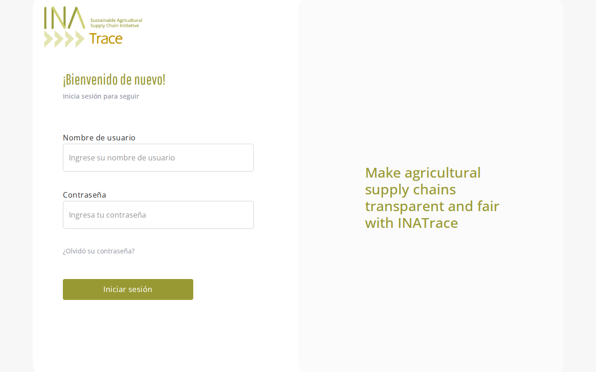 | 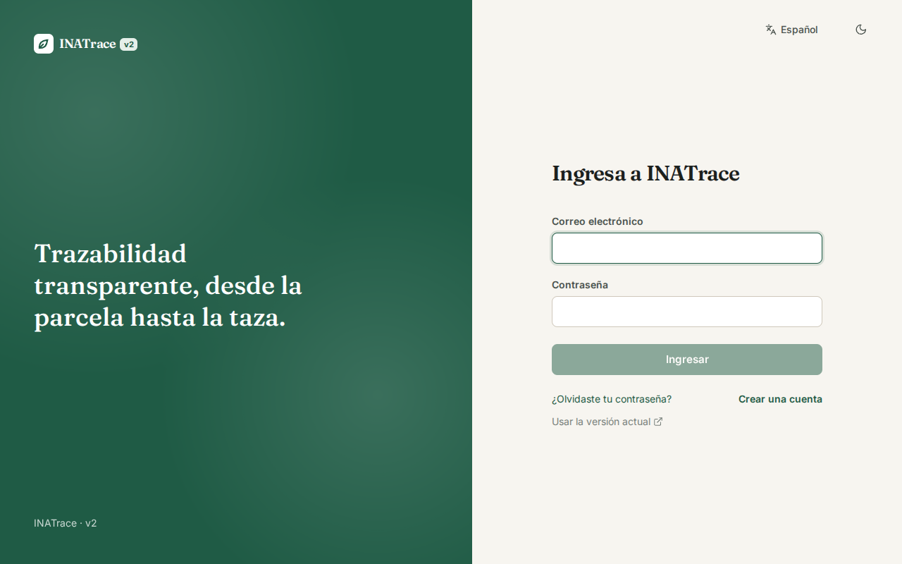 |

- En la interfaz actual, el texto del costado queda en inglés aunque el sitio esté en español.
- La v2 suma «Crear una cuenta» y «¿Olvidaste tu contraseña?» en la misma interfaz, el selector de idioma y
  el modo oscuro.

### Inicio

| Interfaz actual | INATrace v2 |
|---|---|
| 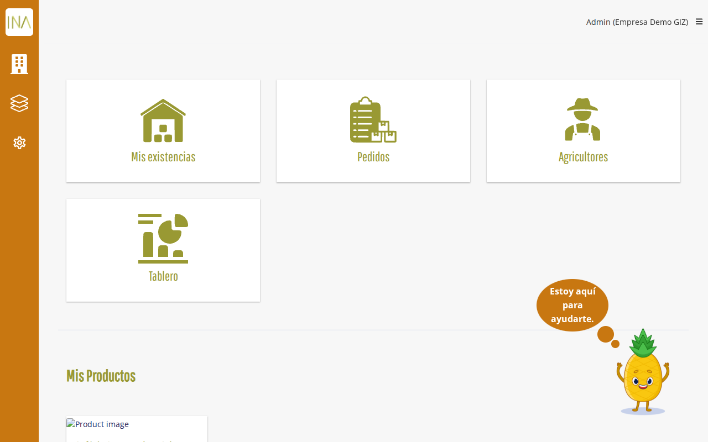 | 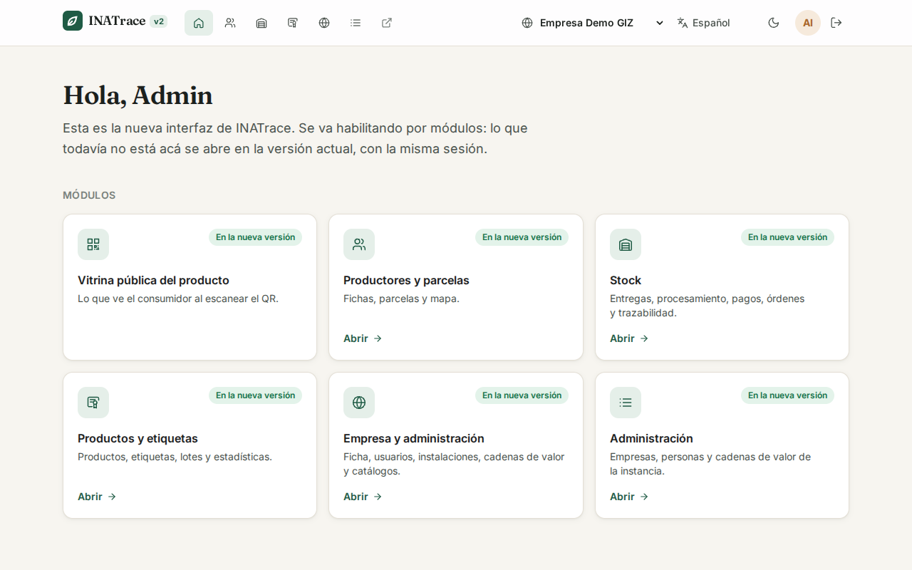 |

- La interfaz actual muestra accesos con ilustraciones y la lista de productos.
- La v2 muestra los módulos con una descripción y la navegación principal siempre arriba, con la empresa
  activa a la vista.

### Productores

| Interfaz actual | INATrace v2 |
|---|---|
| 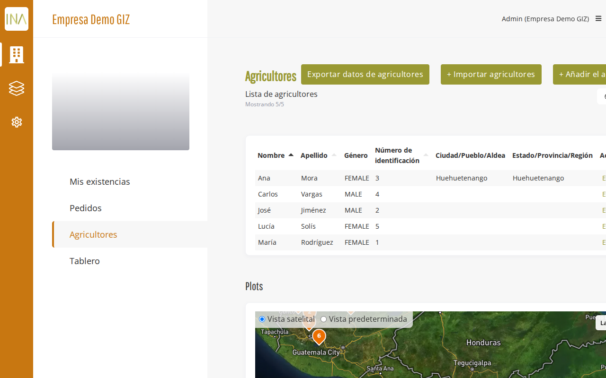 | 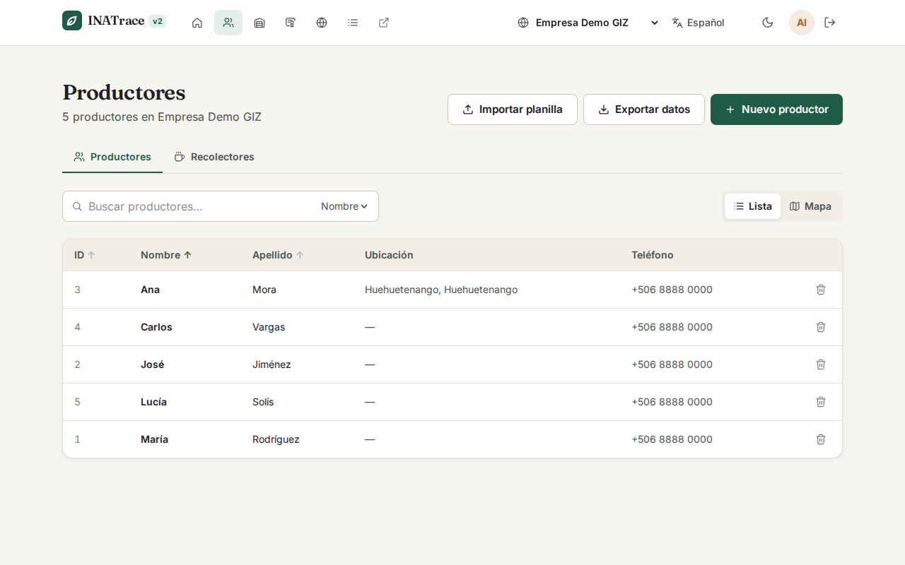 |

- La interfaz actual pone la tabla y el mapa de parcelas uno debajo del otro.
- La v2 separa **lista** y **mapa** con un selector, busca por nombre, ordena por columna y tiene los
  recolectores en una pestaña al lado.

### Ficha de un productor

| Interfaz actual | INATrace v2 |
|---|---|
| 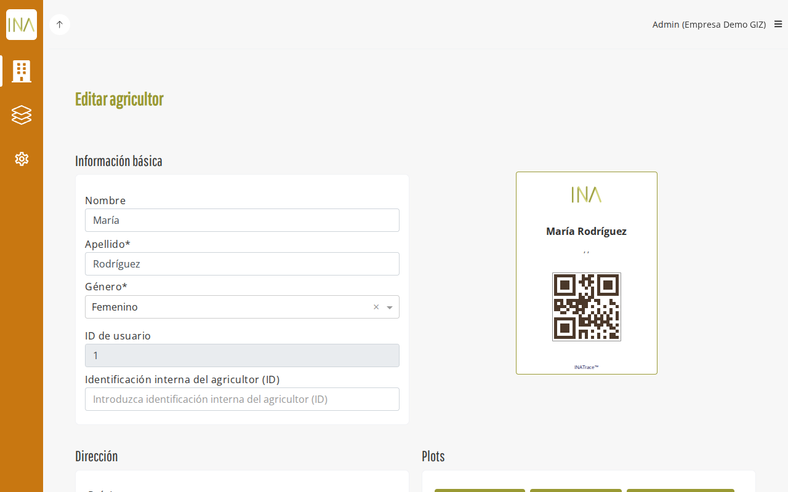 | 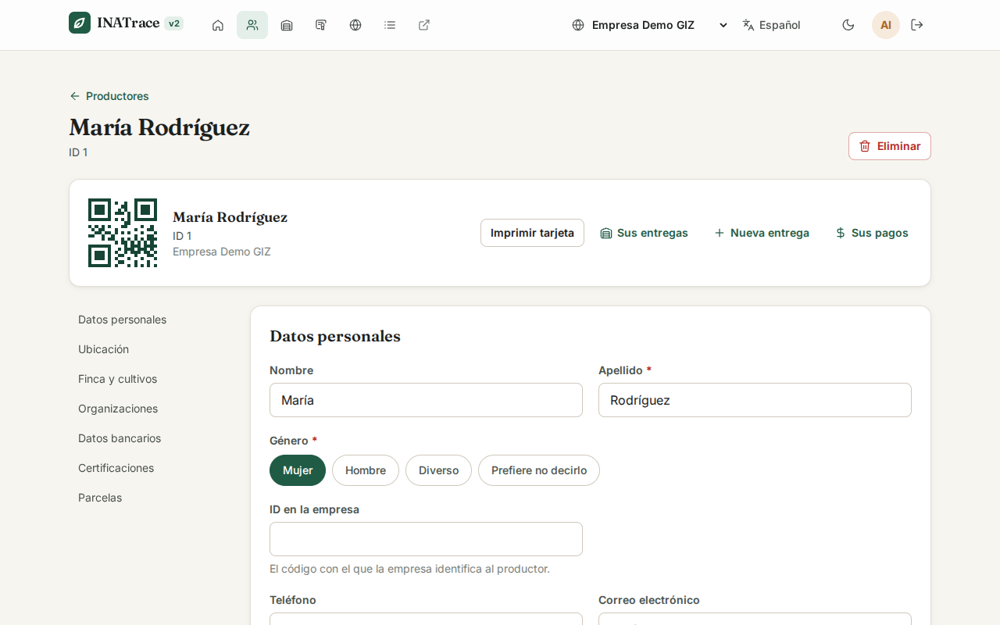 |

- En la interfaz actual es un formulario largo con la tarjeta QR al costado.
- La v2 agrupa la ficha en secciones con un índice a la izquierda, y deja a mano la tarjeta imprimible y los
  atajos a sus entregas, una entrega nueva y sus pagos.

### Entregas

| Interfaz actual | INATrace v2 |
|---|---|
| 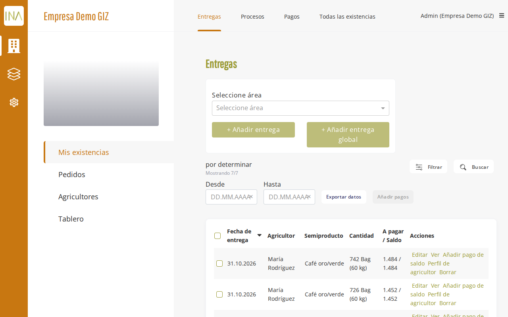 | 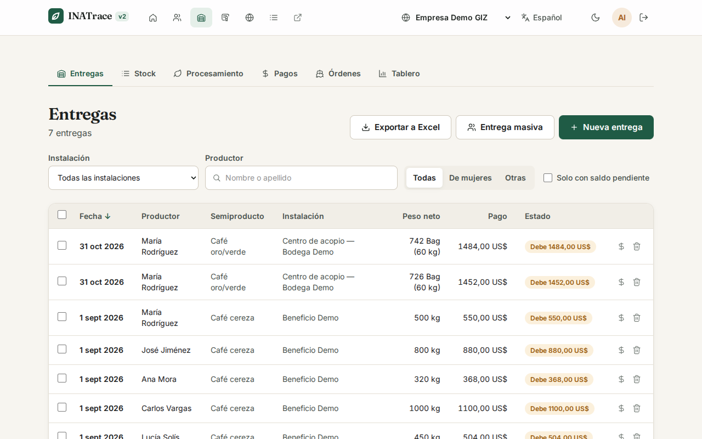 |

- La interfaz actual muestra un selector de área junto a los botones para agregar entregas.
- La v2 muestra las de todas las instalaciones, con filtros (café de mujeres, solo con saldo pendiente), el
  estado del pago de cada entrega, la entrega masiva y la exportación a Excel.

### Etiquetas de un producto

| Interfaz actual | INATrace v2 |
|---|---|
| 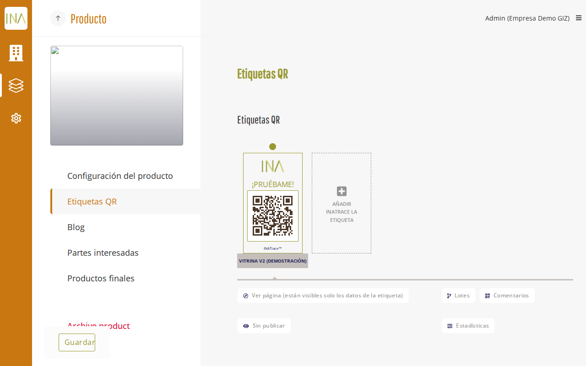 | 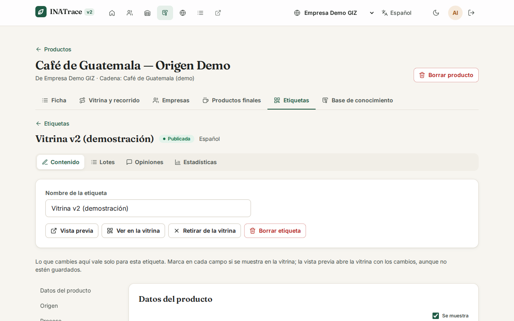 |

- En la interfaz actual las etiquetas son tarjetas con su QR.
- En la v2 cada etiqueta tiene su contenido, lotes, opiniones y estadísticas en pestañas, con vista previa
  de la vitrina antes de guardar.

### Administración: cadenas de valor

| Interfaz actual | INATrace v2 |
|---|---|
| 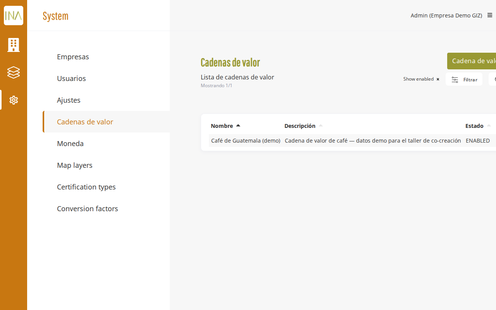 | 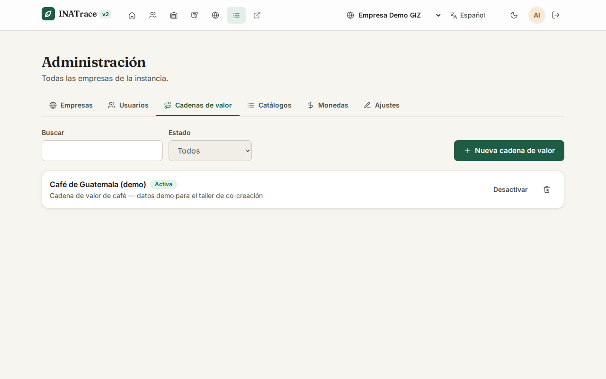 |

- La interfaz actual es una tabla con el menú del sistema a la izquierda.
- La v2 reúne empresas, usuarios, cadenas, catálogos, monedas y ajustes en pestañas, con búsqueda, estado y
  acciones en cada fila.

### En el celular

| Vitrina, antes | Vitrina, después | Productores, antes | Productores, después |
|---|---|---|---|
|  | 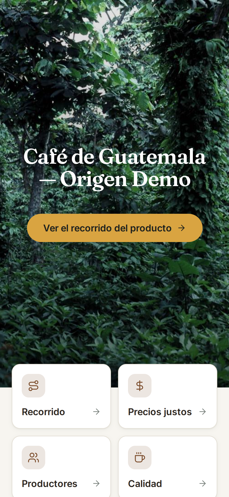 | 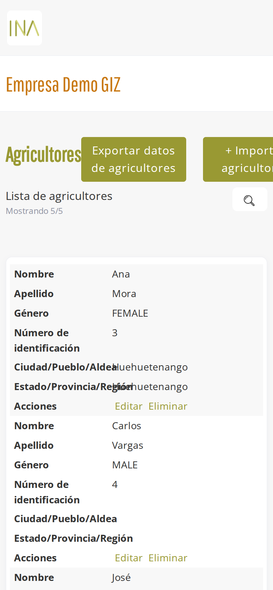 | 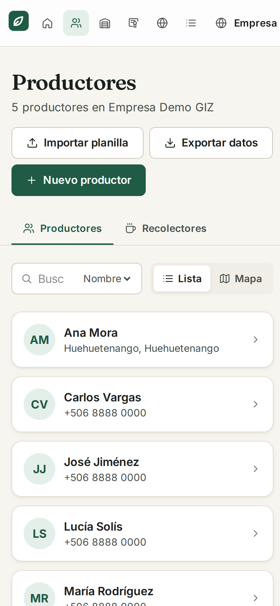 |

- La vitrina se ve parecida, pero la v2 abre con accesos directos a recorrido, precios justos, productores
  y calidad, y pesa menos de una quinta parte.
- En la interfaz actual, la tabla de productores se convierte en una lista de campos y los botones se salen
  del ancho de la pantalla. La v2 usa tarjetas, y una prueba automática verifica que ninguna pantalla quede
  más ancha que el celular.
